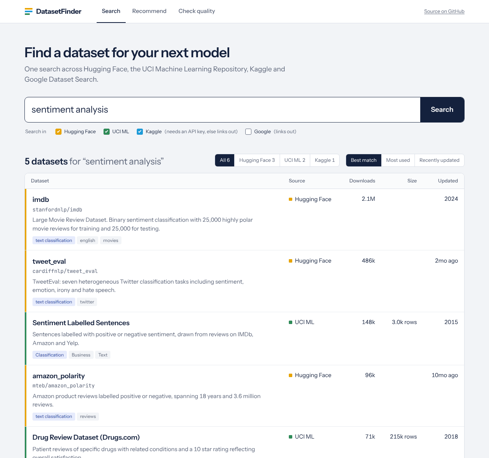
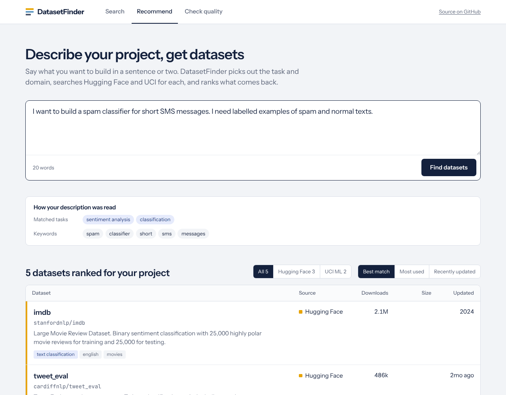
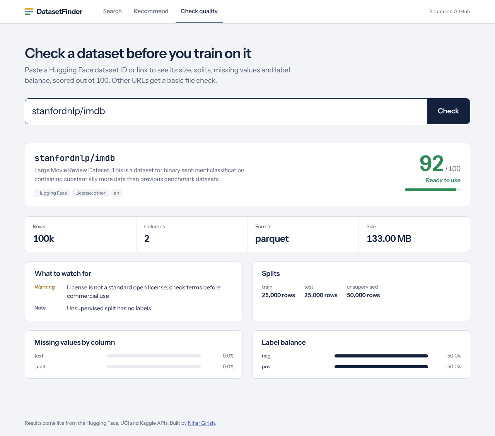
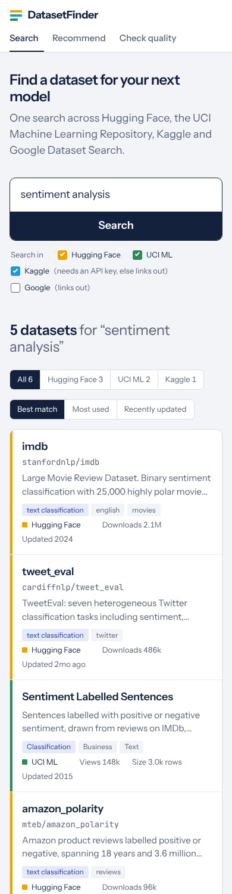

# DatasetFinder

Search for machine learning datasets on Hugging Face, the UCI Machine Learning Repository, Kaggle and Google Dataset Search from one box.

Live: [dazzling-gumption-23f00b.netlify.app](https://dazzling-gumption-23f00b.netlify.app)

## How it works

### Search

Type a topic and tick the sources you want. The results come back as one table. Each row shows the dataset's name and ID, a short description and tags on the left, and downloads, size and last update in columns on the right. A coloured edge marks the source: amber for Hugging Face, green for UCI, blue for Kaggle. You can filter to one source or sort by downloads or update date. The search lives in the URL, so you can bookmark it or send it to someone.



### Recommend

Describe your project in a sentence or two, or start from one of the examples. The recommender matches your words against 17 task patterns (fraud, sentiment, speech, forecasting and more) and pulls out keywords. It searches Hugging Face and UCI for each match, then ranks the combined results by keyword and tag overlap plus popularity. A panel above the results shows how it read your description, so you can rephrase if it guessed wrong.



### Check quality

Paste a Hugging Face dataset ID or link. The checker reads the dataset card and the statistics from the Hugging Face datasets server. You get rows, columns, format, size, splits, missing values per column and label balance, plus a score out of 100 with the issues that cost it points. For any other URL it checks only the format and file size.



On a phone, each result row becomes a stacked card that keeps its source colour.



The screenshots use sample responses, since the live APIs weren't reachable when I took them.

## How it's built

```
src/
  pages/            Search, Recommender, QualityChecker
  components/       Header, Catalogue (results table), loading and error states
  lib/              Number, size and date formatting; source labels and colours
  utils/api.js      Calls to the Netlify functions
  styles.css        All styling, as plain CSS with custom properties
netlify/functions/
  search.js         Queries the Hugging Face, UCI and Kaggle APIs
  recommend.js      Pattern matching, keyword extraction, ranking
  quality.js        Hugging Face card and statistics, quality score
tests/
  format.test.js    Formatting helpers (node --test)
docs/screenshots/   Images used in this README
```

The front end uses React 18, React Router and Vite. Netlify Functions make the API calls on the server, which avoids CORS errors and keeps the optional Kaggle key out of the browser.

## Run it locally

```bash
npm install
npx netlify dev        # app and functions together on http://localhost:8888
```

`npm run dev` starts only the Vite server and forwards function calls to port 8888, so run `netlify dev` next to it if you use it.

```bash
npm test               # unit tests
npm run lint
npm run build
```

### Kaggle

Kaggle results need API credentials. Add these in Netlify's environment settings, or in a local `.env` for `netlify dev`:

```
KAGGLE_USERNAME=your_username
KAGGLE_KEY=your_key
```

Without them, ticking Kaggle adds a link that runs the same search on kaggle.com.

## Design notes

I designed the results to read like a library card catalogue. You compare datasets on a few numbers, so those numbers sit in aligned columns where your eye can run down them.

Instrument Sans sets the interface. JetBrains Mono appears only on dataset IDs like `stanfordnlp/imdb`, because you copy those into code. Fontsource bundles both fonts into the build, so the site loads nothing from a third party.
